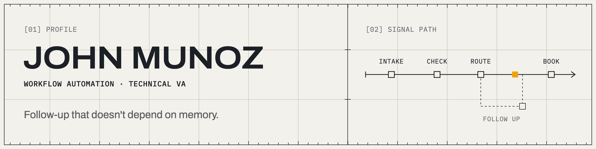

<picture>
  <source media="(prefers-color-scheme: dark)" srcset="assets/banner-dark.png">
  
</picture>

I build automations that take the manual work off a team's plate: CRM setup, lead follow-up, booking, AI calling, and the integrations that connect your tools. Most of my work is in GoHighLevel and n8n. I've been doing it since April 2025, including paid client work for a real estate agency and a mortgage loan officer, and the same systems carry over to any team with repetitive work in its CRM, inbox, or follow-up.

### What I work on

- GoHighLevel subaccounts, pipelines, custom fields, calendars with round-robin booking, snapshots, and workflows
- Lead intake, phone and email validation, routing, tagging, and duplicate prevention
- Campaigns, booking reminders, AI reply handling, and no-show follow-up
- Voice AI with VAPI and Retell, and GHL AI agents for inbound and outbound leads
- n8n, Zapier, and Make, including custom API calls and webhooks
- Lead lists from public sources with Apify, such as Google Maps and Zillow
- SPF, DKIM, DMARC, email warm-up, and A2P 10DLC support

### How I build

Before automation, I spent 6+ years in high-volume customer service with Comcast, AT&T, and Capital One. That's where I learned how slow systems, bad routing, and missed follow-ups hurt customers and teams. So I map the manual process first, then build it and test the cases that usually break: missing fields, invalid numbers, duplicate leads, and no-shows.

### Open source

[lead-intake-checks](https://github.com/jpmunozdev/lead-intake-checks) checks and cleans inbound leads before they reach the CRM: phone, email, name and duplicates. It runs in Node or as one file in an n8n Code node, and comes with 31 messy test leads you can replay against your own workflow.

### Links

Client work stays private, so you won't find it in public repos here. My portfolio builds are on my site.

- Portfolio: [jpmunoz.info](https://jpmunoz.info)
- Book a call: [jpmunoz.info/call](https://jpmunoz.info/call)
- Resume: [jpmunoz.info/resume](https://jpmunoz.info/resume)
- Email: john@jpmunoz.info
